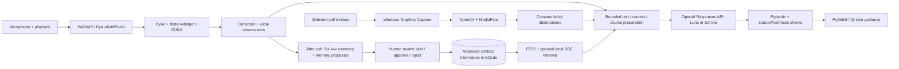

# Conversation Copilot - technologies and flow

Submission/video reference, September 30, 2026. This describes the current source
included in `finalproject.zip`. Dependency versions are declared in `pyproject.toml`.

**One-liner:** A Windows desktop assistant for one-to-one video calls that offers
possible tones, conversational cues, response suggestions, and relevant contact
memories, then lets you review summaries and memory suggestions after the call.

## Major implemented features

- Select a contact, eligible call window, microphone, and playback device.
- Transcribe both sides of an English call locally, with speaker roles based on
  the separate microphone and playback sources.
- Track the selected remote face and derive local facial/vocal observations.
- Display Possible tones, Cues & context, Possible responses, and Related memories;
  inspect explanations/sources, dismiss items, and refresh guidance.
- Generate post-call summaries and proposed memories; edit, approve, or reject them.
- Maintain separate contact histories; search approved memories and summaries,
  ask source-backed questions, correct/delete information, and export it.
- Import two-speaker text transcripts, detect participant labels, and confirm the
  contact mapping before saving.
- Provide light/dark themes, adjustable text size, model selection, and usage estimates.

## Technologies used in the running app

| Technology | What we use it for and why |
| --- | --- |
| **Python 3.12** | Main language for the desktop app, capture pipelines, AI coordination, and storage. One language connects the native Windows interfaces and local AI libraries. |
| **PySide6 / Qt 6.8.3** (`PySide6-Essentials`) | Native Home, Live, Review, Settings, and contact-information screens. Qt supplies widgets, timers, signals, persisted UI preferences, themes, and text sizing. |
| **Windows Win32 APIs via Python `ctypes`** | Discover/filter supported call windows, check their identity/availability, and integrate the app with the Windows shell. Reuses operating-system capabilities. |
| **Windows Graphics Capture, WinRT, Direct3D 11** | Capture frames from the explicitly selected call window. The `winrt-*` packages bridge Windows capture, graphics, imaging, and buffers into Python. No private Zoom/WhatsApp/Meet API is required. |
| **PyAudioWPatch 0.2.12.8 / PortAudio / WASAPI** | Capture the chosen microphone and playback-device loopback separately. This gives the user's speech and the other side's audio distinct source roles. Loopback includes all sound on that playback device. |
| **PyAV 18.1.0 / FFmpeg libraries** | Convert and resample incoming audio into mono 16 kHz PCM for transcription; decode replay media in checks. Uses an existing media library for device-format differences. |
| **faster-whisper 1.2.1 + Whisper large-v3-turbo** | Local English speech-to-text. Exact model: `mobiuslabsgmbh/faster-whisper-large-v3-turbo`, pinned revision `0a363e9161cbc7ed1431c9597a8ceaf0c4f78fcf`. Keeps raw call audio local and avoids a cloud transcription request. Voice-activity filtering is enabled. |
| **CTranslate2 4.8.1 + NVIDIA CUDA libraries** | Run the transcription model on an NVIDIA GPU in float16. Declared libraries are `nvidia-cublas-cu12`, `nvidia-cuda-nvrtc-cu12`, and `nvidia-cudnn-cu12`; a compatible NVIDIA driver is required. This is the current Windows transcription backend. |
| **MediaPipe 1.0.0 / BlazeFace / Face Landmarker** | Detect and track faces and extract landmarks/blendshapes locally. Produces compact facial observations for uncertain interpretation; it does not establish someone's true emotions. The two vision model files are bundled. |
| **OpenCV 5.0.0.93** (`opencv-contrib-python`) | Decode images/video and perform frame preparation, crops, color conversion, and replay checks around the face pipeline. |
| **NumPy 2.5.2** | Efficient audio samples, image arrays, numeric observations, embedding vectors, and similarity calculations. Shared numeric representation across the local pipelines. |
| **OpenAI Python SDK / Responses API** (`openai>=2.54,<3`) | Send bounded text and derived context and receive structured guidance, source-backed answers, participant detection, summaries, and memory proposals. Uses `responses.parse` with schema validation. |
| **Luna 5.6 low** (`gpt-5.6-luna`) | Economical default for Live and Ask; also used for explicit import participant detection. Reasoning effort is `low`. |
| **Sol 6.1 low** (`gpt-6.1-sol`) | Selectable higher-end model for Live and Ask; fixed model for summary generation and memory extraction/review. Reasoning effort is `low`. Historical model IDs in evaluation code are not additional current app choices. |
| **Pydantic 2** | Typed data models and JSON schemas for turns, observations, summaries, memories, and model answers. Rejects malformed structures; separate application checks enforce source and approval boundaries. |
| **SQLite + FTS5** (Python `sqlite3`) | Local contacts, transcripts, summaries, memory revisions, approval states, and usage records. Transactions protect multi-step updates; full-text search supplies keyword retrieval without a database server. |
| **FastEmbed 0.8.0 / ONNX Runtime / BGE-small-en-v1.5** | Optional local semantic recall using `BAAI/bge-small-en-v1.5` and 384-dimensional embeddings. Matches meaning when the exact remembered wording is absent; NumPy compares vectors. Keyword/date/exact retrieval remains available without this model. |
| **Python standard library: `threading`, `queue`, `pathlib`, `json`, `datetime`, `zoneinfo`, etc.** | Background capture/inference/review, bounded queues, file handling, structured exports, and time/date handling. Keeps slow work away from the UI without another task service. |
| **tzdata 2026.3** | Supplies timezone data for `zoneinfo` on Windows, including date-based memory questions. |
| **pip / venv / setuptools** | Install declared dependencies into an isolated Python environment and package the Python module/assets. The ZIP is a source distribution with documented setup commands. |

**Declared supporting dependency:** `Pillow>=11,<13` is in `pyproject.toml`, but
the current app source does not import it directly. It is not a separate live
processing stage; the submission diagram was rendered locally with Pillow.

## Development and testing tools

| Tool | Why it was used |
| --- | --- |
| **Git / GitHub** | Version history, checkpoints, and the private project repository: <https://github.com/simon-levy01/conversation-assistant>. |
| **Trello** | Kanban planning and feature/status tracking: <https://trello.com/b/XeJEDPBa/conversation-copilot-final-project>. |
| **pytest** (`>=9.0.3,<10`) / offscreen Qt | Repeatable offline tests using fictional inputs, temporary stores, and fake providers, including real Qt widgets without desktop interaction. |
| **OpenAI Codex / Claude Code (Opus 5.5 reviews)** | Development assistance, investigation, and independent reviews documented in project evidence. These are development tools, separate from the app's OpenAI API calls. |
| **FFmpeg CLI / Windows System.Speech / OpenAI image generation / HeyGen** | Created fictional audio, portraits, and video-call fixtures for reproducible checks. HeyGen/generated media are test assets, not live-call services. Origins are documented beside the bundled assets. |
| **Ollama and local-model evaluation runners** | Retained research tooling for local model comparisons. Not the current production guidance backend. |

## Basic architecture diagram

Use [TECHNOLOGY-FLOW.png](TECHNOLOGY-FLOW.png) in the video. It shows the same
flow as this diagram:

## When each API/model is called

1. **Setup:** explicit install commands download the pinned transcription model
   and optional embedding model. Call startup uses local caches without downloading.
2. **Start call:** Windows APIs locate/capture the selected window; WASAPI starts
   microphone/playback capture. Local Whisper transcribes speech; local MediaPipe
   processes the selected face. No OpenAI transcription or video upload occurs.
3. **Live guidance:** after speech is available, first analysis becomes eligible
   after 6 seconds. Automatic updates use an adaptive 10-15 second cadence when
   there is eligible new context; Refresh can request another update. Local contact
   retrieval supplies eligible evidence. The selected Luna/Sol model receives
   bounded transcript excerpts, derived observations, and relevant contact text.
   Pydantic and application checks validate the result before Qt displays it.
4. **End call / Review:** the saved transcript is processed with Sol low for
   memory extraction and summary generation. Long sources are chunked and the
   review pipeline can resume. Human review decides which proposals/summaries
   become approved and eligible for future retrieval. Changed summary saves and
   explicit retries can initiate further generation.
5. **Ask:** local retrieval searches the selected contact's approved memories and
   summaries; the selected Luna/Sol model can compose an answer using that evidence.
   Citations must match supplied eligible sources.
6. **Import:** clicking Detect participants sends at most the first 20 shortened
   lines (maximum 8,000 characters), plus contact names, to Luna low. The full
   transcript is parsed locally and the user confirms the participant mapping.
   Imported records use the same post-call summary/memory review pipeline.

## Short explanation to say in the video

"I built Conversation Copilot in Python with a Qt desktop interface. Windows
Graphics Capture reads the selected call window, and WASAPI captures my microphone
and the call playback separately. Whisper transcribes the audio locally on the GPU,
while MediaPipe extracts facial observations locally. The app combines the transcript
and these observations with relevant approved contact memories from SQLite, using
keyword search and optional local semantic embeddings. It sends bounded text and
derived context to OpenAI's Luna or Sol model for possible tones, cues, replies, and
memory reminders. After the call, Sol generates a summary and memory suggestions
that I can edit, approve, or reject. Pydantic validates the structures, and the app
checks the evidence before displaying or saving the results."

## Scope and submission requirements

- Current target: Windows with compatible NVIDIA hardware; English transcription.
  macOS, CPU-only operation, minimum GPU memory, and clean-machine setup remain
  unverified. The ZIP includes vision models and fictional fixtures; larger
  transcription/embedding models are installed separately as explained in README.
- Captured raw audio/video, frames, and landmark/blendshape histories are not saved
  or sent to OpenAI. Relevant text and compact derived observations can be sent.
  OpenAI API calls cost money; normal app operation has no dollar cap.
- The assignment requires a video of **five minutes or less** with the name/one-liner,
  major features, basic technology/flow diagram, and a recording of the features running.
- Upload that video to Google Drive with an anyone-can-view link. Submit a PDF
  containing the video link, GitHub link, and final Kanban screenshot, plus the
  source archive named **`finalproject.zip`**, to Moodle. This reference and source
  ZIP do not replace the required video or submission PDF.

Source evidence: `pyproject.toml`, `README.md`, `conversation_copilot/audio.py`,
`capture.py`, `windows.py`, `video.py`, `semantic.py`, `interpretation.py`,
`guidance.py`, `memory.py`, `post_call.py`, `ask_memory.py`, `import_transcript.py`,
`desktop.py`, and bundled asset provenance files. Assignment requirements were
read from the local "Final project-From Idea To Reality - App Using AI - 2026 (1).pdf".
